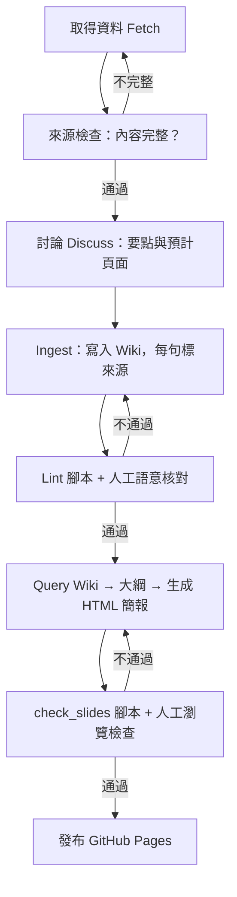

# 量子計算基本概念：LLM Wiki → 教學 HTML 簡報

Repo：https://github.com/welly2140/quantum-wiki

## 1. LLM Wiki 主題與簡介
主題：**量子計算的基本概念**（qubit、疊加、測量、量子閘與電路、糾纏、干涉、退相干、常見迷思）。
Wiki 以 6 篇公開資料為來源，整理成 10 個概念頁，每個事實句都標註來源 `[S1]`~`[S6]`。範圍刻意只做「基本概念」，不含 Deutsch-Jozsa 等特定演算法。

## 2. LLM Wiki 成果
- 目錄：[wiki/index.md](wiki/index.md)　概念頁：[wiki/concepts/](wiki/concepts/)　來源頁：[wiki/sources/](wiki/sources/)
- 原始資料：[raw/](raw/)　Wiki 規則（schema）：[CLAUDE.md](CLAUDE.md)　操作紀錄：[wiki/log.md](wiki/log.md)

| ID | 來源 |
|---|---|
| S1 | Microsoft Learn — What Is Quantum Computing? |
| S2 | IBM Quantum Learning — Quantum information |
| S3 | Wikipedia — Qubit |
| S4 | Wikipedia — Quantum logic gate |
| S5 | Wikipedia — Quantum entanglement |
| S6 | Wikipedia — Quantum computing |

注意：S2–S6 是以 WebFetch 取得的**模型擷取摘要**，不是逐字全文；S4–S6 只讀了頁面前 100000 字元。細節請以原網頁為準。

## 3. 教學 HTML 簡報
- 簡報連結：https://welly2140.github.io/quantum-wiki/slides/
- 原始檔：[slides/index.html](slides/index.html)
- 共 15 張，繁體中文，含 8 張內嵌 SVG 示意圖與 3 題小測驗；左右方向鍵或按鈕翻頁。
- 每張投影片以 `data-wiki` 標註對應的 Wiki 頁面，底部標示資料來源；生成規則見 [slides/PROMPT.md](slides/PROMPT.md)。

## 4. Loop / Graph 設計

- **重複執行**：Fetch→Check→Ingest 每篇資料各跑一次；Ingest↔Lint、Generate↔Check 跑到通過為止。流程由人與 AI 手動觸發，不是全自動程式。
- **檢查／重新生成的地方**：抓取內容是否完整；每句是否有來源、來源是否真的支持該句；簡報的 `data-wiki` 路徑是否存在；簡報數字是否都出現在 Wiki 內。
- **為什麼這樣設計**：把「事實是否正確」的檢查集中在 Wiki 階段（每句附來源），簡報階段只剩「是否忠於 Wiki」的比對，錯誤不會一路傳到最後才發現。
- **可選節點**：`checks/bundle.ps1` 可把 Wiki 合併成 `slides/wiki_bundle.md`，供沒有歷史記憶的其他模型生成簡報；本次實際執行中簡報是由同一個 AI 直接依 Wiki 生成，未使用這一步。

腳本：[lint.ps1](checks/lint.ps1)（Wiki 檢查）、[check_slides.ps1](checks/check_slides.ps1)（簡報檢查）、[bundle.ps1](checks/bundle.ps1)（可選）

## 5. 一次實際執行的結果與檢查紀錄

| 階段 | 發生了什麼 | 處理 |
|---|---|---|
| Fetch | S2–S6 為摘要而非全文，S4–S6 只讀前 100000 字元 | 在 `raw/` 與 `wiki/sources/` 標註取得品質 |
| Discuss | 一次核准整 LLM 批概念清單後逐篇確認 | 在 [wiki/log.md](wiki/log.md) 如實記錄 |
| Lint 第 1 次 | 腳本因 PowerShell 5.1 讀不懂無 BOM 的 UTF-8 中文而解析失敗（工具問題） | 改用 UTF-8 BOM 存檔 |
| Lint 第 2 次 | `LINT PASS`（10 頁） | — |
| 人工語意核對 | 抓到 2 處「有標來源、但來源沒寫」的推論（`quantum-circuits`、`interference`），lint 抓不到 | 改寫為只陳述來源內容 |
| 簡報檢查 第 1 次 | `SLIDE CHECK PASS`，15 張（[報告](checks/report-slides-1.txt)） | — |
| 簡報修改 | 使用者回饋：來源標註太顯眼、需要圖示輔助 | 縮小標註、加 8 張 SVG 圖；第 2 次檢查 PASS（[報告](checks/report-slides-2.txt)） |
| 檢查報告補強 | 發現前兩份報告只有兩行、證據太薄 | 腳本加印逐頁明細，重跑存成 [report-lint.txt](checks/report-lint.txt)、[report-slides-3.txt](checks/report-slides-3.txt)（內容未變，只是輸出更詳細） |
| 人工瀏覽 | 使用者在瀏覽器開啟簡報，版面與翻頁正常 | — |

腳本只檢查結構、來源編號、數字是否出現在 Wiki；**句意是否忠於 Wiki、版面與可讀性仍靠人工檢查**。

## 6. 反思
- **最常出錯的節點是 Ingest。** 有 2 處把來源沒說的推論寫進 Wiki 並標上來源（例如「|+⟩ 與 |−⟩ 只差相對相位」），自動 lint 檢查不出來，因為句子「有標來源」。簡報階段反而沒有出錯，第一次檢查就通過。
- **把檢查前移到 Ingest 之後。** 原本打算簡報做完才檢查；但簡報階段才發現 Wiki 的錯誤，成本更高。所以加入「Ingest 後逐句對照原始資料」的人工核對，並在 `CLAUDE.md` 規定每個事實句必須標來源、簡報只能用 Wiki 內容。
- **因此修改了 workflow：** (1) 在 Wiki 階段新增人工語意核對；(2) 新增 `check_slides` 腳本，要求每張投影片標 `data-wiki`，並比對數字是否在 Wiki 內；(3) 讓檢查腳本輸出逐頁明細，使紀錄可被檢視。
- **仍未解決的限制：** 腳本無法判斷「來源是否真的支持這句話」，這一步目前仍靠人工；S2–S6 又是摘要而非全文，核對時的基準本身也有不確定性。
