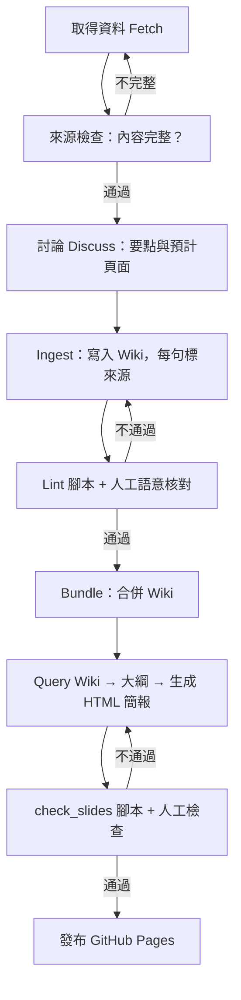

# 量子計算基本概念：LLM Wiki → 教學 HTML 簡報

> 繳交標題：學校 學號 系級 姓名 量子計算基本概念
> （TODO：填入你的學校／學號／系級／姓名）

## 1. LLM Wiki 主題與簡介
主題：**量子計算的基本概念**（qubit、疊加、測量、量子閘與電路、糾纏、干涉、退相干、常見迷思）。
Wiki 以 6 篇公開資料為來源，整理成 10 個概念頁，每個事實句都標註來源 `[S1]`~`[S6]`。

## 2. Wiki 成果
- 目錄：[wiki/index.md](wiki/index.md)　概念頁：[wiki/concepts/](wiki/concepts/)　來源頁：[wiki/sources/](wiki/sources/)
- 原始資料：[raw/](raw/)（S1–S6）　Wiki 規則：[CLAUDE.md](CLAUDE.md)　操作紀錄：[wiki/log.md](wiki/log.md)

| ID | 來源 |
|---|---|
| S1 | Microsoft Learn — What Is Quantum Computing? |
| S2 | IBM Quantum Learning — Quantum information |
| S3 | Wikipedia — Qubit |
| S4 | Wikipedia — Quantum logic gate |
| S5 | Wikipedia — Quantum entanglement |
| S6 | Wikipedia — Quantum computing |

## 3. 教學 HTML 簡報
- TODO：開啟 GitHub Pages 後填入連結，例如 `https://<帳號>.github.io/<repo>/slides/`
- 檔案：[slides/index.html](slides/index.html)（15 張；以 Wiki 為唯一知識來源生成，規則見 [slides/PROMPT.md](slides/PROMPT.md)；每張投影片以 `data-wiki` 標註對應的 Wiki 頁面）

## 4. Loop / Graph 設計

- **重複執行**：Fetch→Check→Ingest 每篇資料各跑一次；Ingest↔Lint、Generate↔Check 跑到通過為止。
- **檢查／重新生成**：抓取是否完整、每句是否有來源且來源真的支持該句、簡報的 `data-wiki` 是否存在、簡報數字是否都在 Wiki 內。
- **為什麼這樣設計**：把「事實是否正確」的檢查集中在 Wiki 階段（每句附來源），簡報階段只剩「是否忠於 Wiki」的比對，錯誤才不會一路傳到最後。
- **為什麼拆成兩個無記憶階段**：簡報由另一個沒看過原始資料的模型生成，只能依賴 Wiki，這同時驗證了 Wiki 是否自足。

腳本：[checks/lint.ps1](checks/lint.ps1)、[checks/bundle.ps1](checks/bundle.ps1)、[checks/check_slides.ps1](checks/check_slides.ps1)

## 5. 一次實際執行的檢查紀錄
Wiki 階段（已完成）：見 [wiki/log.md](wiki/log.md)。摘要：
1. Fetch：S2–S6 為模型擷取摘要而非全文，S4–S6 只讀前 100000 字元，已標註。
2. Lint 第 1 次：腳本因 UTF-8 編碼解析失敗（工具問題），改用 BOM 修正。
3. Lint 第 2 次：PASS。
4. 人工語意核對：抓到 2 處「有標來源但來源沒寫」的推論（`quantum-circuits`、`interference`），已改寫為只陳述來源內容。

簡報階段：第 1 次執行 `check_slides.ps1`，輸出 `slides: 15` 與 `SLIDE CHECK PASS`（見 [checks/report-slides-1.txt](checks/report-slides-1.txt)）。
- 第 2 次：使用者回饋「來源標註太顯眼、需要圖示輔助」，縮小來源標註並加入 8 張 SVG 示意圖（指數增長、Bloch 球、振幅、測量、糾纏、干涉、退相干、迷思）後重跑，同樣 PASS（見 [checks/report-slides-2.txt](checks/report-slides-2.txt)）。
- 第 3 次：發現前兩份報告只有結果兩行、證據太薄，於是讓兩支腳本加印「逐頁明細」（每頁事實句數與來源、每張投影片對應的 Wiki 頁與來源），重跑並存成 [checks/report-lint.txt](checks/report-lint.txt) 與 [checks/report-slides-3.txt](checks/report-slides-3.txt)（內容無變動，只是輸出更詳細；`report-slides-1/2` 保留為舊版輸出）。
- 腳本只檢查結構、來源編號與數字是否在 Wiki 內；**版面、可讀性與句意是否忠於 Wiki，仍需人工在瀏覽器檢查**。
- TODO：你自己打開簡報後，若發現問題，把修正前後的紀錄補在這裡（例如 report-slides-2.txt）。

## 6. 反思
- **最常出錯的節點**：目前實測是 Ingest（把來源沒說的推論寫進 Wiki 並標上來源）。簡報節點的結果待填。
- **檢查前移**：原本只打算在簡報完成後檢查；因為 lint 只能確認「有標來源」、無法確認「來源支持該句」，所以加入 Ingest 後的人工語意核對，並規定簡報只能用 Wiki 內容、每張投影片標 `data-wiki`。
- **Workflow 修改**：新增「Bundle」節點與 `check_slides` 腳本，讓簡報生成階段不依賴對話歷史，並能機械檢查。
- TODO：簡報跑完後補上實際發現的問題。
